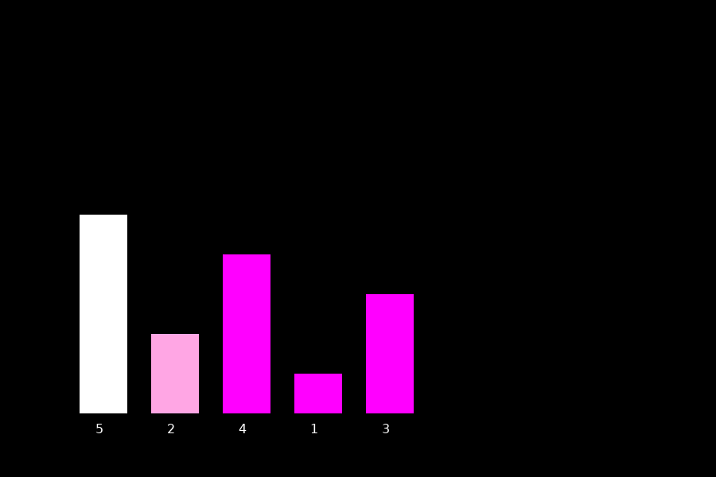

<h1 align="center">Sorting Visualizer</h1>

<p align="center">
  Visualizing sorting algorithms with Java.
</p>

<p align="center">
  
</p>

## About

Sorting Visualizer is a Java project that demonstrates how sorting algorithms work through a graphical representation of an array.

The application uses Java Swing to draw the array and animate the sorting process, making each comparison and movement easier to follow.

## Current Algorithm

### Selection Sort

The current implementation uses Selection Sort. During the animation, the visualizer highlights the element being inspected and the smallest element found in the unsorted portion of the array.

## Features

- Graphical array visualization with Java Swing
- Animated Selection Sort
- Highlighting of the current element and the current minimum
- Real-time updates while the array is being sorted

## Technologies

- Java
- Java Swing
- Java AWT

## Project Structure

```text
SortingVisualizer/
├── Main.java
├── VizualizerFrame.java
├── ArrayPanel.java
├── SelectionSort.java
├── assets/
│   └── sorting-visualizer-jframe.gif
└── README.md
```

## How to Run

Make sure the Java JDK is installed.

Clone the repository:

```bash
git clone YOUR_REPOSITORY_URL
```

Open the project folder:

```bash
cd SortingVisualizer
```

Compile the Java files:

```bash
javac *.java
```

Run the application:

```bash
java Main
```

## Planned Improvements

- [ ] Add Bubble Sort
- [ ] Add Insertion Sort
- [ ] Add more sorting algorithms
- [ ] Allow selecting the algorithm
- [ ] Add controls for the animation

---

<p align="center">
  Developed by Cayenne Galante · 2026
</p>
